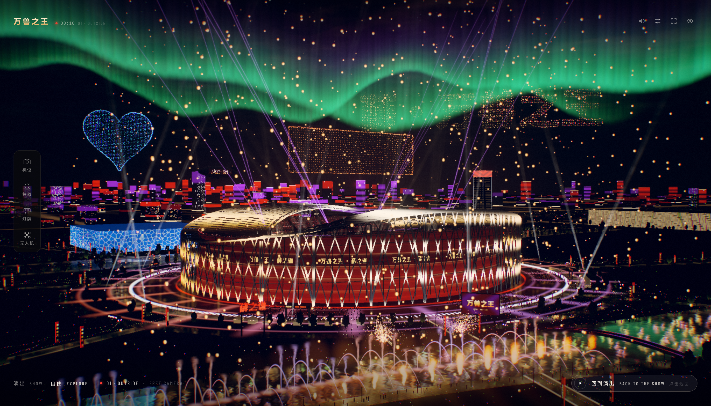
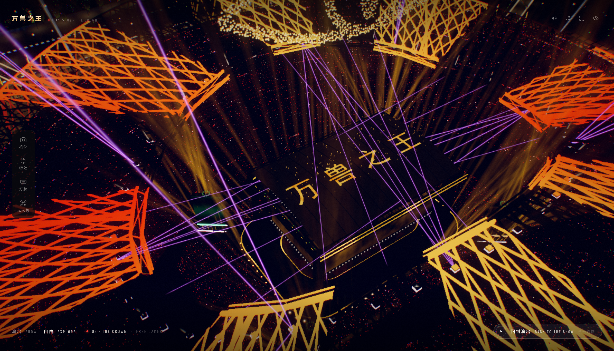
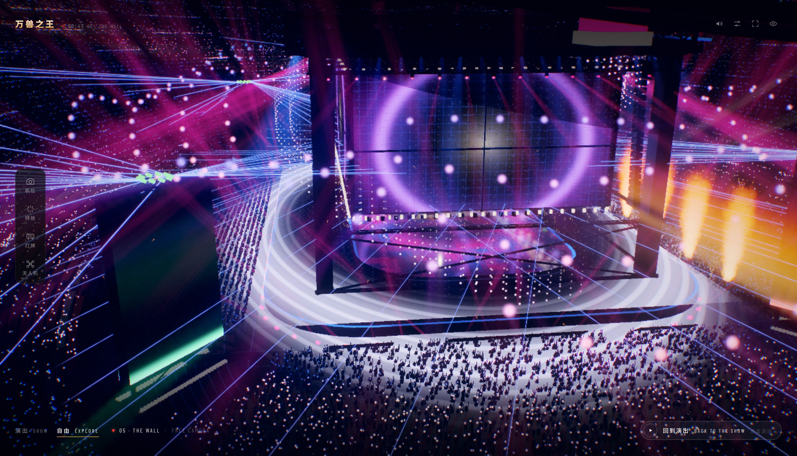
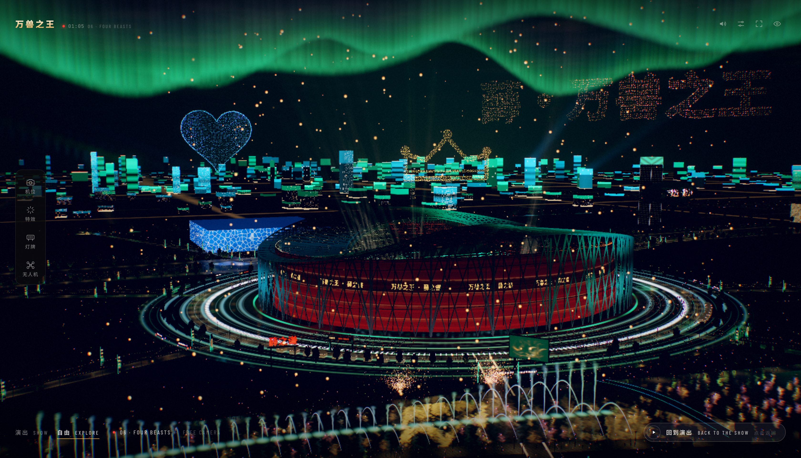
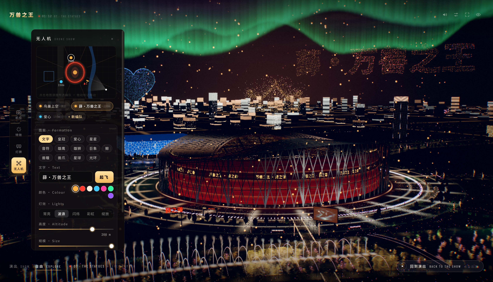
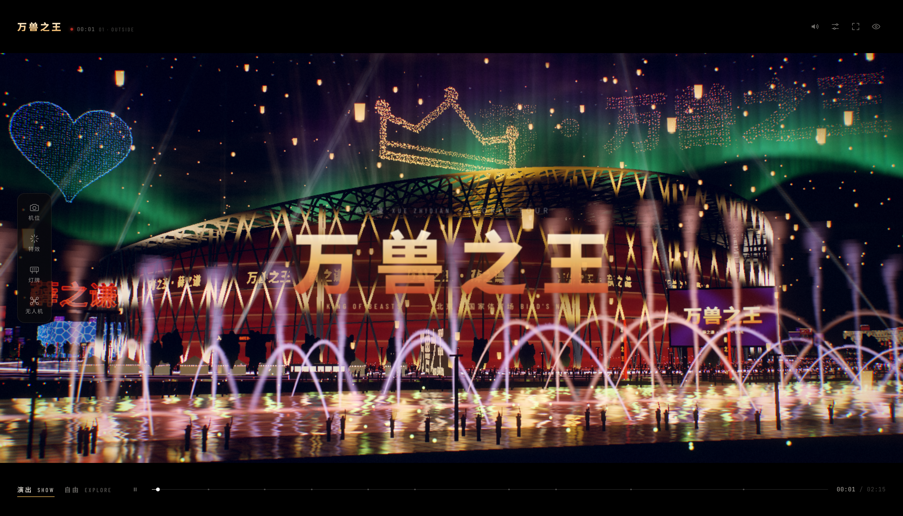
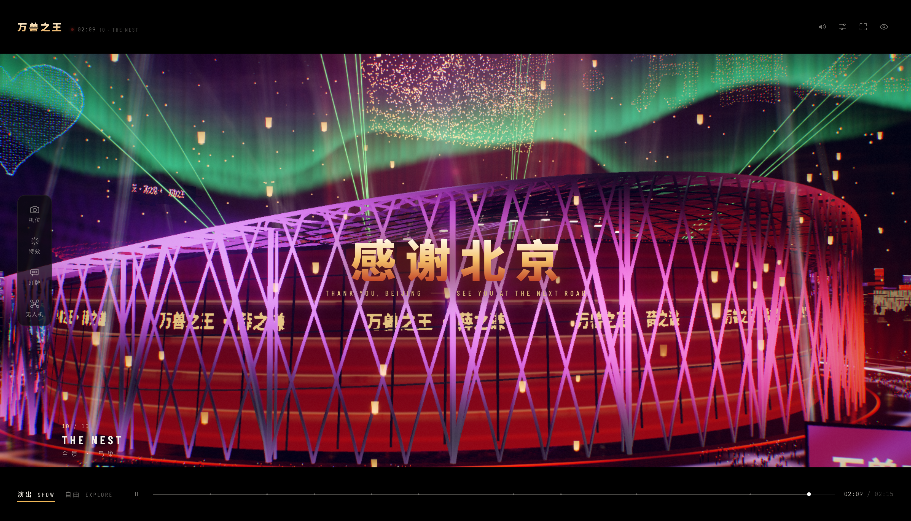
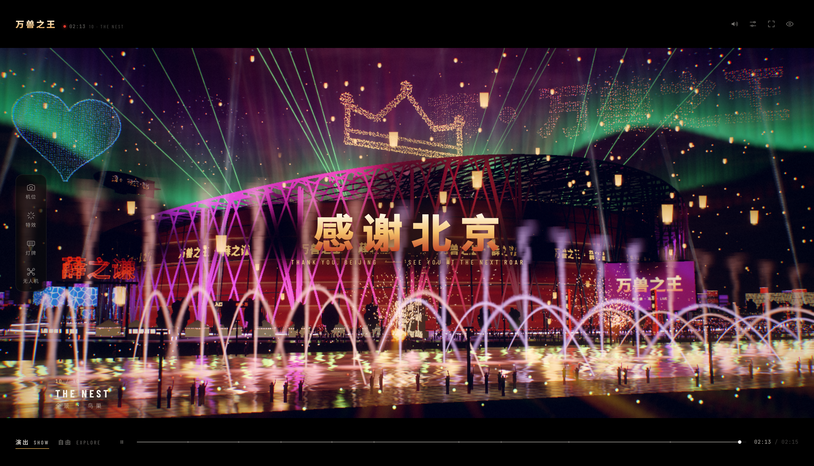
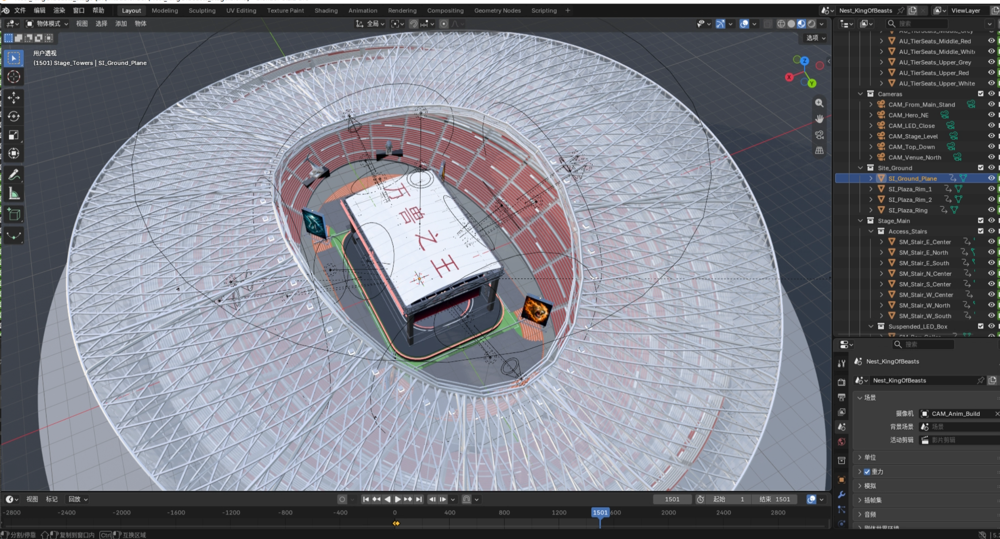

# 万兽之王 · 鸟巢 — King of Beasts Live

> **薛之谦「万兽之王」鸟巢演唱会 · 实时三维灯光秀**
> A real-time 3D concert visualisation of Joker Xue's *King of Beasts* show at the Bird's Nest, Beijing.

[简体中文](#项目说明) · [English](#english-version)

## 🤝 友情链接 / Friend Links

| 站点 Site | 链接 Link |
| :--- | :--- |
| 🤖 **Ai 资源网** | <https://human.rlybtd.com/> |

---

无需安装、无需构建、无需后端 —— 双击 `index.html`，一场 2 分 15 秒的完整演出就在浏览器里开始。

**No install, no build, no server — open `index.html` and the show starts in your browser.**

| 项目 | 内容 |
| :--- | :--- |
| 主题 | 薛之谦「万兽之王」北京鸟巢演唱会 |
| 形式 | 实时三维灯光秀 · 可交互的虚拟演出现场 |
| 时长 | 2 分 15 秒 · 10 个章节 · 128 BPM · 自动循环 |
| 模式 | 演出 SHOW · 自由 EXPLORE |
| 技术 | three.js r160 · WebGL 2 · GLSL · WebAudio |
| 运行 | 纯静态页面，可直接托管在 GitHub Pages |
| 许可 | MIT License，详见 [LICENSE](LICENSE) |

## 截图 / Screenshots

点击任意图片查看原始分辨率。 / Click any image to open the full-resolution original.

<p align="center">
  <a href="screenshot/1.png"></a><br>
  <sub>鸟巢夜景 · 极光、无人机与音乐喷泉 / The Nest at night — aurora, drones and the musical fountain</sub>
</p>

<p align="center">
  <a href="screenshot/2.png"></a>
  <a href="screenshot/3.png"></a><br>
  <sub>屋顶题字 · 万兽之王 / The Crown　|　主屏、光环与激光 / The Wall</sub>
</p>

<p align="center">
  <a href="screenshot/4.png"></a>
  <a href="screenshot/5.png"></a><br>
  <sub>四兽苏醒 · 巢外全景 / Four Beasts　|　无人机编队编辑器 / Drone-fleet editor</sub>
</p>

<p align="center">
  <a href="screenshot/6.png"></a>
  <a href="screenshot/7.png"></a><br>
  <sub>主墙题字与音乐喷泉 / King of Beasts　|　谢幕 · 感谢北京 / Thank you, Beijing</sub>
</p>

<p align="center">
  <a href="screenshot/8.png"></a><br>
  <sub>谢幕全景 · 感谢北京 / The closing wide shot</sub>
</p>

### Blender 建模 / Blender Modeling

<p align="center">
  <a href="screenshot/blender.png"></a><br>
  <sub>场馆与舞台模型 · Blender 视口 / Venue and stage model in Blender</sub>
</p>

---

## 项目说明

**万兽之王 · 鸟巢** 是一个完全运行在浏览器里的实时三维演唱会场景。它以薛之谦「万兽之王」北京鸟巢演唱会为题材，用 three.js 重建了鸟巢、龙形水系与奥林匹克公园的夜景，并以 128 BPM 的节拍驱动一场 2 分 15 秒的完整灯光秀。

项目没有构建步骤，也没有后端。场馆模型原样嵌入仓库，灯光、激光、烟花、火焰、无人机、灯牌、人群与声音全部由代码实时生成；打开网页就能看，也可以随时切换到自由视角，像坐在现场导播台前一样自己触发特效、摆灯牌、放飞无人机。

### 亮点

- **一场完整的导演秀**：10 个章节、2 分 15 秒、128 BPM 卡点，自动循环播放。
- **两种观看方式**：演出模式自动导播；自由模式可飞行、环视、切换 16 个机位，演出不会暂停。
- **20 组大型特效**：场内 11 组、场外 9 组，外加烟花、火焰、激光、频闪、冷焰、彩带、火花瀑布与人浪；一键「特效巡礼」自动巡演全部 20 组。
- **灯牌编辑器**：最多 8 块灯牌，实时改文字、颜色、霓虹/灯泡/像素样式、动态、字高、离地高度与朝向；外墙跑马灯、广场灯柱和场外大屏可同步。
- **无人机编队**：最多 3 个自定义编队，每队 2,200 架；支持文字、皇冠、爱心、星星、音符、兽瞳、兽爪、星球、光环与四兽图案。
- **场馆之外**：龙形水系与音乐喷泉、雨后广场、奥林匹克公园、城市天际线、水立方、玲珑塔、奥林匹克塔、车流、人群与探照灯。
- **自适应画质**：根据 GPU 自动选择并实时调整，也可手动锁定低 / 中 / 高 / 极高四档。
- **程序化音频**：鼓点、贝斯、Pad、人群、烟花爆点均由 WebAudio 实时合成；烟花声音按距离延迟到达。
- **零安装**：纯静态 HTML + JavaScript，无 npm、无打包、无服务器依赖。

### 演出章节

| # | 时间 | 章节 | Chapter | 画面 |
| :--- | :--- | :--- | :--- | :--- |
| 01 | 00:00 | 序幕 · 巢外 | Outside | 镜头掠过龙形水系，鸟巢倒映水中，第一轮烟花在屋顶上空炸开。 |
| 02 | 00:11 | 题字 · 点燃 | The Crown | 镜头越过屋顶，屋顶「万兽之王」点亮，金色光环沿钢结构升起。 |
| 03 | 00:22 | 降临 · 穿顶 | Descent | 镜头从屋顶开口俯冲进入场馆，星河在头顶展开。 |
| 04 | 00:31 | 台前 · 烈焰 | Stage Front | 贴着舞台前沿低飞，火焰、冷焰与激光打开，主屏开始自下而上点亮。 |
| 05 | 00:43 | 主屏 · 点亮 | The Wall | 镜头升起，完整呈现主墙从地面到屋顶的点亮。 |
| 06 | 00:52 | 四兽 · 苏醒 | Four Beasts | 鹰、狮、象、鲸四座兽塔依次通电，火龙卷随每座兽塔升起。 |
| 07 | 01:11 | 群像 · 守望 | The Statues | 镜球降下，光斑爬满看台，雕像与追光掠过人群。 |
| 08 | 01:20 | 人海 · 光潮 | The Crowd | 荧光棒汇成光海，激光幕与看台字幕铺满全场，无人机在头顶变换队形。 |
| 09 | 01:35 | 终章 · 万兽之王 | Finale | 全息巨兽升起，烟花与火环在场上空接连炸开，演出进入最高潮。 |
| 10 | 01:58 | 全景 · 鸟巢 | The Nest | 镜头升出屋顶并拉远，极光、打铁花、城市灯光与孔明灯在夜空收尾，谢幕卡片出现。 |

### 两种模式

| 模式 | 说明 |
| :--- | :--- |
| **演出 SHOW**（默认） | 导演视角自动运镜，按 128 BPM 的时钟依次触发灯光、火焰、烟花与无人机。画面为 2.2:1 电影画幅，底部时间轴可点击跳转章节。 |
| **自由 EXPLORE** | 鼠标环视 / 平移 / 缩放，`W A S D` 飞行，`Q / E` 升降，`Shift` 加速。演出继续运行，灯光、激光、烟花、人群和无人机不会停。 |

自由模式是**锁定**的：只能通过底部模式栏的「演出」按钮或「回到演出 · BACK TO THE SHOW」按钮返回，按键和计时都不会自动退出。

### 技术实现

| 层面 | 做法 |
| :--- | :--- |
| 渲染 | three.js r160（CDN 自动回退 jsDelivr → unpkg → npmmirror）、WebGL 2、自定义 HDR 后处理链（泛光、变形拉丝、景深、运动模糊、体积光、色调映射）。 |
| 模型 | `model.glb` 原样使用；同时以 base64 glTF-Binary（Draco）内嵌在 `js/model-data.js`，因此 `file://` 直接打开也能看到完整场馆。 |
| 灯光 | 单一自定义灯光循环替代约 30 盏 three.js 灯光，覆盖 LED 箱体、兽塔、烟花、火焰、频闪、追光与王座灯。 |
| 粒子 | 烟花、火焰、光雨、金箔、无人机等使用 GPU 点精灵 / 实例化；低画质档自动减量。 |
| 音频 | WebAudio 程序化合成，无音频文件；烟花声按 343 m/s 的距离延迟到达。 |
| 自适应 | 启动时按 GPU 选择档位并试跑校准；运行中根据帧率逐步降低渲染比例或档位，不重编译着色器。 |
| 存档 | 灯牌与无人机布局保存在浏览器 `localStorage`，URL 参数优先级更高。 |

---

## 使用说明

### 运行要求

- 桌面版 Chrome / Edge / Firefox / Safari，建议开启硬件加速，需要支持 WebGL 2。
- 首次打开需要联网：three.js 从公共 CDN 加载（jsDelivr → unpkg → npmmirror 自动回退）。
- 模型约 15–19 MB，首次加载需要一点时间；之后浏览器会缓存。
- 建议戴耳机。浏览器要求用户点击页面后才能播放声音。
- 手机 / 平板可以打开（自动使用低画质），但本项目是为桌面大屏体验设计的。

### 快速开始

**方式一：直接打开（最简单）**

双击 `index.html`，等待启动画面结束，点击「进入演出 · ENTER WITH SOUND」或「静音进入 · Enter silently」。

**方式二：本地静态服务器（推荐）**

```bash
cd xue-Concert
python3 -m http.server 8080
```

然后打开 <http://localhost:8080>。通过 http(s) 访问时，页面会直接读取 `model.glb`，比内嵌的 base64 副本更省流量、启动更快。

**方式三：部署到 GitHub Pages**

1. 将仓库推送到 GitHub。
2. 打开仓库 **Settings → Pages → Build and deployment**，选择 **Deploy from a branch**，分支选 `main`，目录选 `/ (root)`。
3. 保存后访问 `https://<用户名>.github.io/<仓库名>/`。

无需 GitHub Actions，也无需任何构建命令。

### 进入演出与界面

启动画面加载完成后有两个按钮：

- **进入演出 · ENTER WITH SOUND**：从第 1 章开始播放并启用声音。
- **静音进入 · Enter silently**：先不出声，之后可点右上角声音按钮或按 `M` 开启。

进入后默认为「演出」模式，自动循环播放。演出界面刻意保持安静：

- **顶栏**：左侧为字标与演出时钟；右侧为声音、画质菜单、全屏和隐藏界面。
- **底栏**：演出 / 自由模式切换，以及一条细时间轴；鼠标悬停可看章节名，点击可跳转。
- **章节字卡**：每次进入新章节时短暂出现。
- 几秒无操作后界面自动淡出，移动鼠标即可恢复。隐藏界面后右上角会留一只淡淡的“眼睛”，点击即可唤回。

### 操作说明

| 操作 | 按键 / 手势 | 说明 |
| :--- | :--- | :--- |
| 旋转视角 | 鼠标左键拖动 | 自由模式 |
| 缩放 | 鼠标滚轮 | 自由模式 |
| 平移 | 鼠标右键拖动 | 自由模式 |
| 水平飞行 | `W` `A` `S` `D` | 自由模式 |
| 下降 / 上升 | `Q` / `E` | 自由模式 |
| 加速飞行 | `Shift` | 飞行时按住 |
| 切换机位 | `1`–`9`、`0` | 前 10 个机位；完整 16 个在左侧「机位」面板 |
| 进入自由模式 | `Space` | 演出模式下按下即进入 |
| 回到演出 | 底部「演出」按钮或「回到演出」按钮 | 自由模式锁定，按键不会自动返回 |
| 声音开关 | `M` | |
| 隐藏 / 显示界面 | `H` | 隐藏后点右上角眼睛恢复 |
| 全屏 | `F` | |
| 上一章 / 下一章 | `←` / `→` | 演出模式 |
| 暂停 / 继续 | `K` | 演出模式 |
| 关闭左侧面板 | `Esc` | |
| 跳转章节 | 点击时间轴 | 悬停显示章节名 |

### 左侧控制台

左侧竖排四个标签，点击展开对应面板。控制台在两种模式下都能用；选择机位会自动切换到自由模式。

| 标签 | 功能 |
| :--- | :--- |
| **机位 Cameras** | 16 个预设机位，相机沿平滑弧线飞过去。 |
| **特效 Effects** | 经典特效、场内 11 组、场外 9 组大型特效；亮点表示该特效正在运行。顶部「特效巡礼」会自动巡演全部 20 组，约 3 分钟。 |
| **灯牌 Light signs** | 布局编辑器。小地图实时显示场馆、湖面、广场、相机与所有灯牌；最多 8 块，点击地图放置、拖动标记移动。 |
| **无人机 Drones** | 同一张小地图。鸟巢上空的编队默认跟随演出，也可以自定义最多 3 个编队，每队 2,200 架。 |

**灯牌**可设置文字（或点选预设）、颜色、样式（霓虹 / 灯泡 / LED 像素）、动态（常亮 / 追光 / 呼吸 / 彩虹）、字高、离地高度和朝向，并支持「朝向镜头」「飞过去看」「删除」。外墙跑马灯有独立文字，还可同步到广场灯柱和场外大屏。

**无人机编队**支持文字、皇冠、爱心、星星、音符、雄鹰、雄狮、巨象、鲸、兽瞳、兽爪、星球、光环 13 种图案，以及颜色、灯效（常亮 / 波浪 / 闪烁 / 彩虹 / 绽放）、高度、规模、朝向，并支持「朝向镜头」「观看编队」「解散」。文字编队按真实无人机秀的方式绘制：每一笔都有清晰轮廓，内部均匀填充。

所有布局保存在浏览器中，下次打开会自动恢复；URL 参数会覆盖已保存的设置。

### 特效一览

**经典（随时触发）**：烟花、火焰、激光、频闪、CO₂ 冷焰、彩带、火花瀑布、人浪。

**场内 11 组**：光环、镜球、全息巨兽、冲击波、光之雨、火环、火龙卷、金箔雪、激光沙漏、看台字幕、星河。

**场外 9 组**：孔明灯、极光、水上火焰、莲花灯、地面投影、萤火、城市灯光、LED 飞艇、打铁花。

场外特效与场馆灯光、湖面音乐喷泉、广场投影、城市天际线联动；场内特效会驱动观众手中的荧光棒、看台字幕和屋顶结构灯。

### 画质与性能

默认 `quality=auto`：先根据 GPU 型号选择档位（核显 / Apple M 系列 → 中，移动端和软件渲染 → 低，独显 → 高），再在启动画面后试跑几帧校准；运行中如果帧率不足，会先小步降低渲染比例，再降到下一档。所有调整都不会触发着色器重编译，因此不会卡住画面。

也可以在右上角画质菜单中手动切换 **AUTO / LOW / MEDIUM / HIGH / ULTRA**。加上 `?stats=1` 可显示帧率、分辨率、绘制调用、活动灯光数和识别到的 GPU。

| 档位 | 像素预算 | MSAA | 台面倒影 | 景深 | 其他 |
| :--- | :--- | :--- | :--- | :--- | :--- |
| low | 0.55 MP | – | – | – | 光束与粒子减半，灯棒减少 |
| medium | 1.0 MP | 2× | 1/4 分辨率，隔帧更新 | 12 taps | 75% 粒子 |
| high | 1.9 MP | 2× | 1/4 分辨率 | 20 taps | 看台剪影 |
| ultra | 3.6 MP | 4× | 1/4 分辨率 + 光束 | 28 taps | |

如果设备较弱，可以尝试：

- 画质切到 `low` 或 `medium`；
- 用 `?fps=30` 限制帧率，画面会更稳；
- 用 `?scale=0.7` 固定更低的渲染比例；
- 关闭浏览器其他占用 GPU 的标签页，并确认已开启硬件加速。

### URL 参数

参数有三种设置方式，优先级为：**URL 查询参数 > `<script>` 上的 `data-*` 属性 > `window.KOB_CONFIG` > 内置默认值**。

- 直接改 `index.html` `<head>` 里的 `window.KOB_CONFIG`；
- 或在 `<script src="js/kob-main.js" id="kob-main">` 上加 `data-*`，例如 `data-quality="ultra"`；
- 或在地址栏中覆盖，例如：

```text
index.html?mode=free&view=6&quality=ultra
index.html?chapter=9&speed=0.5
index.html?sign=鸟巢见&signColor=gold&ticker=true
index.html?drone=薛之谦&droneShape=text&droneColor=cyan
```

| 参数 | 默认值 | 说明 |
| :--- | :--- | :--- |
| `mode` | `play` | `play` 演出模式 / `free` 自由模式 |
| `t` | `0` | 起始时间（秒，0–135） |
| `chapter` | – | 起始章节 1–10，优先于 `t` |
| `speed` | `1` | 演出时钟倍率（0.05–4） |
| `loop` | `true` | 是否循环；`false` 在结尾停止 |
| `quality` | `auto` | `auto` / `low` / `medium` / `high` / `ultra` |
| `scale` | – | 固定渲染比例（0.25–2，相对设备像素） |
| `fps` | `0` | 帧率上限；`0` 跟随显示器刷新率，弱机可设 `30` |
| `audio` | `false` | 首次交互后自动尝试开启声音 |
| `volume` | `0.8` | 主音量（0–1） |
| `ui` | `true` | 是否显示界面 |
| `letterbox` | `true` | 演出模式是否显示 2.2:1 电影黑边 |
| `idle` | `0` | 自由模式无操作多少秒后回到演出；`0` 表示永不 |
| `ev` | `0` | 曝光补偿（-4 到 +4 档） |
| `bloom` | `1` | 泛光强度倍率（0–4） |
| `flare` | `1` | 镜头光晕 / 拉丝强度（0–4） |
| `grain` | `1` | 胶片颗粒强度（0–4） |
| `haze` | `1` | 空气 / 烟雾密度（0–4） |
| `dof` | `true` | 景深开关 |
| `mblur` | `true` | 运动模糊开关 |
| `shake` | `1` | 手持 / 冲击抖动倍率（0–4） |
| `fireworks` | `1` | 烟花密度倍率（0–3） |
| `crowd` | `1` | 荧光棒密度倍率（0–3） |
| `drones` | `1` | 无人机数量倍率（0–3） |
| `view` | – | 自由模式初始机位（0–15） |
| `seed` | `7` | 人群 / 火焰随机种子 |
| `stats` | `false` | 显示帧率等统计信息 |
| `cdn` | `auto` | `auto` / `jsdelivr` / `unpkg` / `npmmirror` |
| `capture` | `false` | 关闭动画循环，用 `__viewer.renderAt(t)` 逐帧渲染 |
| `gate` | `true` | 启动 / 入场页 |
| `titles` | `true` | 开场与谢幕字卡 |
| `autohide` | `3.5` | 演出模式界面自动隐藏秒数；`0` 表示永不 |
| `sign` | – | 第一块灯牌的文字 |
| `signColor` | – | `gold` `red` `white` `cyan` `magenta` `jade` `violet` 或 `#rrggbb` |
| `signStyle` | – | `neon` / `bulbs` / `led` |
| `signAnim` | – | `steady` / `chase` / `pulse` / `rainbow` |
| `ticker` | – | `true` / `false`，外墙跑马灯 |
| `drone` | – | 自定义编队文字（自动切换为文字图案） |
| `droneShape` | – | `text` / `crown` / `heart` / `eye` / `claws` / `sphere` / `rings` |
| `droneColor` | – | 同 `signColor` |
| `droneFx` | – | `steady` / `wave` / `sparkle` / `rainbow` |
| `droneSpot` | – | `behind` / `lake` / `crown` |

### 常见问题

**打开后是黑屏或提示无法启动**
three.js 需要从公共 CDN 加载。请检查网络、代理或防火墙，然后刷新；也可以强制指定镜像，例如 `index.html?cdn=npmmirror`。

**没有声音**
浏览器禁止自动播放音频，必须先点击「进入演出」；之后可按 `M` 或点右上角声音按钮检查开关。也请确认系统音量和浏览器标签页没有被静音。

**画面卡顿 / 风扇很响**
把画质降到 `low` 或 `medium`，或加上 `?fps=30`、`?scale=0.7`。关闭其他占用 GPU 的页面，并确认浏览器已启用硬件加速。

**修改代码后看到的还是旧版本**
强制刷新（Windows：`Ctrl+F5`；macOS：`Cmd+Shift+R`）。页面自带构建号检查，检测到旧缓存时会自动重载一次。

**字体和截图不太一样**
界面字体来自 Google Fonts；网络不可用时会回退到系统字体，功能不受影响。

**第一次加载很慢**
首次需要下载 three.js 和约 15–19 MB 的模型；之后浏览器会缓存。用本地服务器或 GitHub Pages 打开时读取 `model.glb`，比 `file://` 下的内嵌副本更快。

---

## 项目结构

| 文件 | 内容 |
| :--- | :--- |
| `index.html` | 页面结构、界面标记、默认参数 |
| `css/show.css` | 界面样式（字体来自 Google Fonts） |
| `js/kob-params.js` | URL / `data-*` / 配置参数解析与范围限制 |
| `js/kob-show.js` | 演出程序：10 个章节、相机路径、灯光与特效 cue 表、机位 |
| `js/kob-glsl.js` | 着色器：LED 内容、光束、激光、粒子、人群、大气、镜头处理 |
| `js/kob-fx.js` | 特效系统：光束、激光、粒子池、烟花、火焰、人群、表演者、无人机、烟雾 |
| `js/kob-sfx.js` | 20 组大型特效及其目录（驱动特效台与「特效巡礼」） |
| `js/kob-world.js` | 奥林匹克公园外景：湖、地面、路灯、树木、人群、车流、城市、地标 |
| `js/kob-post.js` | HDR 后处理：大气、景深、运动模糊、泛光、拉丝、色调映射 |
| `js/kob-ui.js` | 界面控制器（顶栏、底栏、章节卡、自动隐藏） |
| `js/kob-deck.js` | 左侧控制台：灯牌与无人机布局编辑器 |
| `js/audio.js` | WebAudio 程序化配乐与音效 |
| `js/kob-main.js` | 启动、场馆材质与灯架、导演相机、自由相机、运行时 |
| `js/model-data.js` | 内嵌场馆模型（base64 glTF-Binary，Draco） |
| `model.glb` | 原始场馆模型（约 15 MB） |

> `index.html` 通过 http(s) 打开时会直接读取 `model.glb`；通过 `file://` 双击打开时则使用内嵌模型，因此两种方式都能离线观看。

## 开发者接口

页面启动后，控制台可访问 `window.__viewer`：

| 成员 | 说明 |
| :--- | :--- |
| `scene`, `camera`, `controls` | three.js 场景、相机与 OrbitControls |
| `VIEWS` | 16 个机位；每个包含 `name`、three.js 坐标 `pos` / `tgt`、Blender 坐标 `posB` / `tgtB`、镜头焦距 `lens`（mm） |
| `flyTo(index, immediate)` | 飞到指定机位；`immediate` 为 `true` 时无过渡 |
| `setMode(mode)` | 切换演出 / 自由模式（`'play'` 或 `'free'`） |
| `seek(seconds)` | 跳到指定演出时间 |
| `showTime`, `state`, `quality` | 当前演出时间、状态与画质档位 |
| `setQuality(name)` | 手动设置画质 |
| `renderAt(t, { mode, view, warm, quality })` | 渲染指定时间的一帧，返回 JPEG data URL |
| `bench(t, frames)` | GPU 性能测试 |

演出数据使用 Blender 坐标编写（米，Z 轴向上，+X 指向主舞台），引擎按 `(x, y, z) → (x, z, −y)` 转换到 three.js 空间。

> 项目当前构建号为 **12**。所有脚本启动时都会校验构建号；如果浏览器缓存了旧文件，页面会自动重载一次，否则提示强制刷新。

---

## 版权与声明

- 本项目是「万兽之王」演唱会主题的实时三维可视化作品，不代表演唱会主办方或艺人的官方发布。
- 三维模型、舞台设计、演唱会名称、艺人姓名、标识及相关美术素材的版权归各自权利人所有；本项目仅将它们用于展示与技术交流。
- 仓库中的代码以 MIT 许可证开源，详见 [LICENSE](LICENSE)。三维模型、舞台设计、演唱会名称、艺人姓名、标识及相关美术素材不在 MIT 许可证范围内；未经授权，请勿将它们用于商业用途。
- 字体由 Google Fonts 提供，three.js 以 MIT 许可证分发。

---

## English Version

A real-time 3D concert visualisation of Joker Xue's *King of Beasts* show at the Beijing National Stadium (the Bird's Nest). Everything runs in the browser: the venue, the Olympic Green, the lighting, lasers, fireworks, drones, light signs, crowd and soundtrack are rendered and generated live. There is no build step and no backend — open the page and the show begins.

### Highlights

- **A directed show**: 10 chapters, 2 min 15 s, cut to a 128 BPM clock, looping automatically.
- **Two ways to watch**: SHOW runs the director's camera path; EXPLORE gives you free flight, 16 viewpoints and full camera control while the show keeps running.
- **20 set pieces**: 11 in the bowl and 9 outside, plus fireworks, flames, lasers, blinders, CO₂, confetti, spark fall and crowd surges. A guided *Tour* fires all 20 in about three minutes.
- **Light-sign builder**: up to 8 giant signs with live text, colour, neon/bulb/LED styles, motion, height, elevation and facing; the wall ticker can also drive the banner towers and the fan screen.
- **Drone fleets**: up to 3 custom fleets of 2,200 drones each, with text, crown, heart, star, note, beast eye, claws, planet, rings and the four beast portraits.
- **Outside the Nest**: the Dragon-shaped lake and its musical fountain, a wet plaza, the Olympic Green, the city skyline, the Water Cube, Ling Long Tower and the Olympic Tower, plus traffic, crowds and searchlights.
- **Adaptive quality**: auto-detected from the GPU and adjusted live, with four manual tiers.
- **Procedural sound**: kick, bass, pads, crowd and fireworks are synthesised with WebAudio; firework reports arrive late by distance.
- **Zero install**: static HTML and JavaScript only — no npm, no bundler, no server-side code.

### Show chapters

| # | Time | Chapter | 中文 | Scene |
| :--- | :--- | :--- | :--- | :--- |
| 01 | 00:00 | Outside | 序幕 · 巢外 | A low pass over the Dragon Lake, the Nest reflected in the water, the first firework barrage over the roof. |
| 02 | 00:11 | The Crown | 题字 · 点燃 | The camera rises over the roof as 万兽之王 ignites and gold light rings climb the steel lattice. |
| 03 | 00:22 | Descent | 降临 · 穿顶 | A dive through the roof opening into the bowl, through a spiral galaxy. |
| 04 | 00:31 | Stage Front | 台前 · 烈焰 | A low run along the stage front as flames, CO₂ and lasers open up; the wall starts to ignite from the floor. |
| 05 | 00:43 | The Wall | 主屏 · 点亮 | The camera rises to take in the whole LED box, lit floor-to-roof. |
| 06 | 00:52 | Four Beasts | 四兽 · 苏醒 | The eagle, lion, elephant and whale towers power up in turn, each with a fire tornado. |
| 07 | 01:11 | The Statues | 群像 · 守望 | The mirror ball drops, light spots crawl round the stands, follow spots sweep the statues. |
| 08 | 01:20 | The Crowd | 人海 · 光潮 | Light sticks become a sea of light; laser curtains and card stunts fill the bowl while the drone fleet changes formation overhead. |
| 09 | 01:35 | Finale | 终章 · 万兽之王 | The hologram beast rises as fireworks and fire rings burst over the field in the closing climax. |
| 10 | 01:58 | The Nest | 全景 · 鸟巢 | The camera rises out of the roof and pulls back while aurora, iron flowers, the city light show and sky lanterns close the night; the closing card appears. |

### Two modes

| Mode | What it does |
| :--- | :--- |
| **SHOW** (default) | A directed 2.2:1 picture cut to a 128 BPM clock. The show autoplays and loops; click the timeline to jump to any chapter. |
| **EXPLORE** | Orbit, pan and zoom with the mouse; fly with `W A S D`, down/up with `Q / E`, hold `Shift` to go faster. The show, lights, lasers, pyro, crowd and fireworks never pause. |

Explore is locked: only the **Show** tab (演出) or the **BACK TO THE SHOW** button leaves it. No key and no timer does.

### Quick start

**Option 1 — open the file**

Double-click `index.html`, wait for the boot screen, then press **ENTER WITH SOUND** or **Enter silently**.

**Option 2 — local server (recommended)**

```bash
cd xue-Concert
python3 -m http.server 8080
```

Open <http://localhost:8080>. Over http(s), the page fetches `model.glb` directly, which is smaller than the embedded base64 copy.

**Option 3 — GitHub Pages**

1. Push the repository to GitHub.
2. Go to **Settings → Pages → Build and deployment**, choose **Deploy from a branch**, branch `main`, folder `/ (root)`.
3. Open `https://<user>.github.io/<repo>/`.

No Actions or build command is needed.

### Requirements

- A recent desktop Chrome, Edge, Firefox or Safari with WebGL 2 and hardware acceleration.
- Network access on first load: three.js comes from a public CDN (jsDelivr → unpkg → npmmirror, first one that answers).
- The model is 15–19 MB, so the first load takes a moment; it is cached afterwards.
- Headphones recommended. Browsers only start audio after a click.
- Phones and tablets work at the low tier, but the experience is designed for a large desktop screen.

### Controls

| Action | Input | Notes |
| :--- | :--- | :--- |
| Orbit | Left-drag | Explore mode |
| Zoom | Mouse wheel | Explore mode |
| Pan | Right-drag | Explore mode |
| Fly | `W` `A` `S` `D` | Explore mode |
| Down / up | `Q` / `E` | Explore mode |
| Fast flight | `Shift` | Hold while flying |
| Viewpoints | `1`–`9`, `0` | First 10 views; all 16 are in the **Cameras** tab |
| Enter Explore | `Space` | From SHOW |
| Back to the show | **Show** tab (演出) or **BACK TO THE SHOW** | Explore is locked; no key returns automatically |
| Sound | `M` | |
| Hide / show interface | `H` | A faint eye stays in the top-right corner |
| Fullscreen | `F` | |
| Previous / next chapter | `←` / `→` | SHOW mode |
| Pause / resume | `K` | SHOW mode |
| Close the left panel | `Esc` | |
| Jump to a chapter | Click the timeline | Hover for chapter names |

### Control deck

A rail of four tabs sits on the left edge, so the picture stays clear. The deck works in both modes; picking a camera switches to Explore.

| Tab | What it does |
| :--- | :--- |
| **Cameras 机位** | 16 viewpoints; the camera flies there in a smooth arc. |
| **Effects 特效** | The classics, 11 set pieces in the bowl and 9 outside. A lit dot marks every effect running right now. The gold **Tour** button fires all 20 in turn in about three minutes. |
| **Light signs 灯牌** | A layout builder with a live mini-map. Add up to 8 signs, place them by clicking the map or dragging their markers. Each sign takes text or a preset, colour, style (neon / bulbs / LED pixels), motion (steady / chase / pulse / rainbow), letter height, elevation and facing, plus *face the camera*, *fly to it* and delete. The wall ticker has its own line of words, which can also run on the banner towers and the fan screen. |
| **Drones 无人机** | The same map. The fleet over the Nest follows the show until you give it a formation. Add up to 3 custom fleets of 2,200 drones each, anywhere on the map. Each takes text or a formation — crown, heart, star, music note, beast eye, claws, planet, rings, or one of the four beast portraits — plus colour, light effect (steady / wave / sparkle / rainbow / bloom), altitude, size and facing, and *face the camera*, *watch* and *disband*. Text is drawn the way real drone shows draw it: a crisp outline of every stroke plus an even fill. |

Layouts are saved in the browser and restored on the next visit; URL parameters override them.

### Set pieces

**Classics**: fireworks, flames, lasers, blinders, CO₂, confetti, spark fall, crowd surge.

**In the bowl (11)**: halo hoops, mirror ball, hologram beast, shockwave, light rain, ring of fire, fire tornado, gold snow, laser hourglass, card stunt, galaxy.

**Outside (9)**: sky lanterns, aurora, fire on water, lotus lights, plaza mapping, fireflies, city light show, LED blimp, iron flowers.

All of them are added effect geometry (the venue model is untouched) and animate on the GPU; a rig at level 0 is hidden and costs nothing.

### Quality and performance

`quality=auto` (default) picks a tier from the GPU name, times a few frames behind the boot screen, and steps down if needed. While running it lowers the render scale in small steps when frames are slow, then drops to the next tier. No tier change recompiles a shader, so adapting never freezes the picture. The **AUTO / LOW / MEDIUM / HIGH / ULTRA** menu sets a tier by hand; `?stats=1` shows fps, resolution, draw calls, active lights and the detected GPU.

| Tier | Pixel budget | MSAA | Deck mirror | DOF | Other |
| :--- | :--- | :--- | :--- | :--- | :--- |
| low | 0.55 MP | – | – | – | half the beams and particles, fewer light sticks |
| medium | 1.0 MP | 2× | ¼ res, every 2nd frame | 12 taps | 75% particles |
| high | 1.9 MP | 2× | ¼ res | 20 taps | bowl silhouettes |
| ultra | 3.6 MP | 4× | ¼ res + beams | 28 taps | |

If the picture stutters, try `low` / `medium`, `?fps=30`, or `?scale=0.7`; close other GPU-heavy tabs and make sure hardware acceleration is on.

### URL parameters

Precedence: **URL query > `data-*` on the main script tag > `window.KOB_CONFIG` > built-in defaults**.

Edit `window.KOB_CONFIG` in the `<head>` of `index.html`, add `data-*` attributes to `<script id="kob-main">`, or override per visit:

```text
index.html?mode=free&view=6&quality=ultra
index.html?chapter=9&speed=0.5
index.html?sign=鸟巢见&signColor=gold&ticker=true
index.html?drone=薛之谦&droneShape=text&droneColor=cyan
```

| Key | Default | Meaning |
| :--- | :--- | :--- |
| `mode` | `play` | `play` or `free` |
| `t` / `chapter` | `0` / – | start time in seconds / chapter 1–10 |
| `speed`, `loop` | `1`, `true` | show clock multiplier; loop or stop at the end |
| `quality` | `auto` | `auto`, `low`, `medium`, `high`, `ultra` |
| `scale` | – | fixed render scale (fraction of device pixels) |
| `fps` | `0` | frame-rate cap; `30` gives a steadier picture on weak GPUs |
| `audio`, `volume` | `false`, `0.8` | start sound on first interaction; master volume |
| `ui`, `letterbox`, `idle` | `true`, `true`, `0` | interface; 2.2:1 bars; seconds of inactivity in Explore before returning to the show (0 = never) |
| `ev`, `bloom`, `flare`, `grain`, `haze` | `0`, `1`, `1`, `1`, `1` | exposure compensation and lens / atmosphere strengths |
| `dof`, `mblur`, `shake` | `true`, `true`, `1` | depth of field, motion blur, handheld + impact shake |
| `fireworks`, `crowd`, `drones` | `1` | density multipliers |
| `view` | – | free-mode viewpoint 0–15 |
| `seed`, `stats`, `cdn` | `7`, `false`, `auto` | variation seed; fps readout; force a CDN |
| `capture` | `false` | no animation loop; render frames with `__viewer.renderAt(t)` |
| `gate`, `titles`, `autohide` | `true`, `true`, `3.5` | entry screen; title cards; inactivity before the interface fades |
| `sign`, `signColor`, `signStyle`, `signAnim`, `ticker` | – | light-sign text, colour, style, motion, wall ticker |
| `drone`, `droneShape`, `droneColor`, `droneFx`, `droneSpot` | – | custom fleet text, shape, colour, light effect, placement |

### Project structure

| File | Contents |
| :--- | :--- |
| `index.html` | markup, interface, default parameters |
| `css/show.css` | interface styles (Google Fonts) |
| `js/kob-params.js` | parameter parsing and clamping |
| `js/kob-show.js` | show programme: chapters, camera path, cue sheet, pyro and firework schedule, viewpoints |
| `js/kob-glsl.js` | shaders: LED content, beams, lasers, particles, crowd, atmosphere, lens pipeline |
| `js/kob-fx.js` | effect systems: beams, lasers, particle pools, fireworks, pyro, crowd, performer, drones, haze |
| `js/kob-sfx.js` | the 20 set pieces and their catalogue (drives the effects desk and tour) |
| `js/kob-world.js` | the Olympic Green: lake, ground, lamps, trees, fans, traffic, city, landmarks |
| `js/kob-post.js` | HDR pipeline: atmosphere, DOF, motion blur, bloom, streaks, tonemap |
| `js/kob-ui.js` | interface controller |
| `js/kob-deck.js` | layout builder (light signs and drone fleets) |
| `js/audio.js` | procedural soundtrack |
| `js/kob-main.js` | boot, venue materials and light rig, director camera, free camera, runtime |
| `js/model-data.js` | embedded model (base64 glTF-Binary, Draco) |
| `model.glb` | original venue model (about 15 MB) |

Show data is authored in Blender space (metres, Z up, +X = main stand); the engine converts with `(x, y, z) → (x, z, −y)`.

### Developer API

`window.__viewer` exposes `scene`, `camera`, `controls`, `VIEWS` (each with `name`, `pos`/`tgt`, `posB`/`tgtB`, `lens`), `flyTo(index, immediate)`, `setMode('play'|'free')`, `seek(seconds)`, `showTime`, `state`, `quality`, `setQuality(name)`, `renderAt(t, { mode, view, warm, quality })` (returns a JPEG data URL) and `bench(t, frames)`.

The build number is **12**. Every script checks in with it at start-up; if the browser serves a stale cached file, the page reloads itself once and otherwise asks for a hard refresh.

### Troubleshooting

**Black screen or "Could not start"** — three.js is loaded from a public CDN. Check the network, proxy or firewall, then reload; you can force a mirror with `index.html?cdn=npmmirror`.

**No sound** — browsers only start audio after a click. Press **ENTER WITH SOUND**, then check the sound button or `M`; also check the tab and system volume.

**Low frame rate** — switch to `low` or `medium`, try `?fps=30` or `?scale=0.7`, close other GPU-heavy tabs and enable hardware acceleration.

**Still seeing an old version** — hard refresh (`Ctrl+F5` / `Cmd+Shift+R`). The build check reloads once automatically.

**Different fonts** — interface fonts come from Google Fonts; when they cannot load, the system fallback is used and everything still works.

### Copyright

This is a real-time 3D visualisation project themed around the *King of Beasts* concert; it is not an official release by the concert organiser or the artist. The code is released under the MIT License (see [LICENSE](LICENSE)). The 3D model, stage design, concert name, artist name, logos and related artwork remain the property of their respective owners, are not covered by the MIT licence, and are used here for demonstration and technical discussion only; please do not use them commercially without permission. Fonts are provided by Google Fonts and three.js is distributed under the MIT licence.
